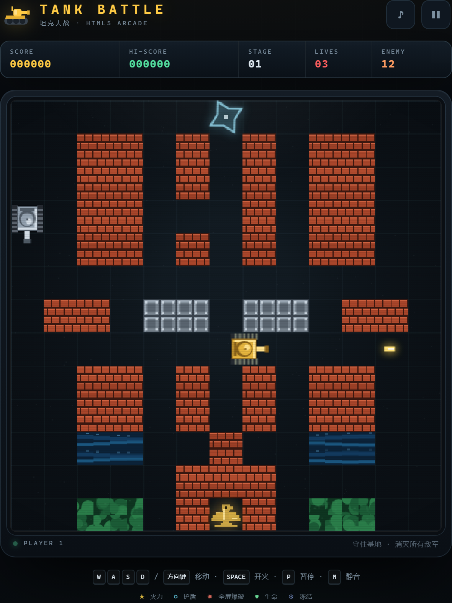
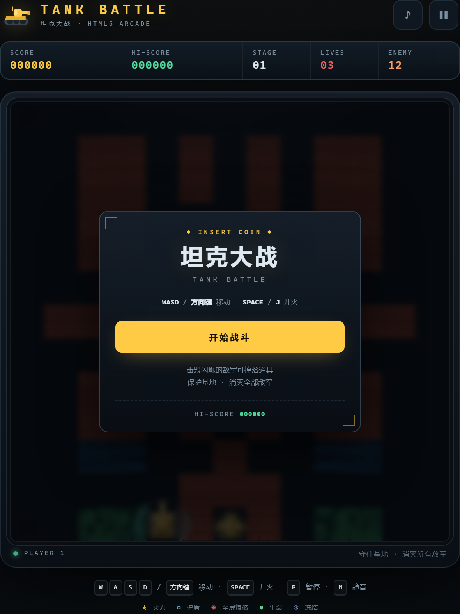
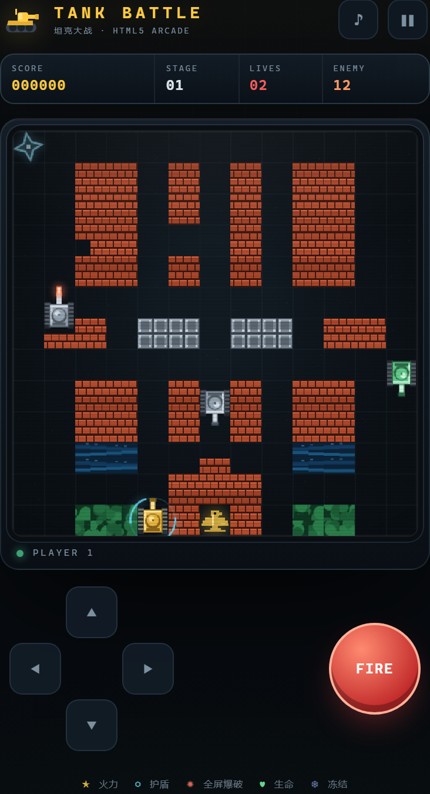

<p align="center">
  
</p>

<h1 align="center">坦克大战 · Tank Battle</h1>

<p align="center">
  致敬经典《坦克大战》（Battle City）的纯前端像素街机游戏。<br>
  HTML5 Canvas + 原生 JavaScript，零依赖，打开即玩。
</p>

<p align="center">
  
  
  
</p>

<p align="center">
  <a href="https://trace-path.github.io/tank-battle/"><b>▶ 在线试玩</b></a>
  &nbsp;·&nbsp;
  <a href="#本地运行">本地运行</a>
  &nbsp;·&nbsp;
  <a href="#操作说明">操作说明</a>
</p>

---

## 游戏简介

基地就剩最后一道砖墙，敌军坦克正从三个方向压来。驾驶你的黄色坦克，穿过草丛、绕过河流、打穿砖墙，守住基地并消灭所有来犯之敌。

- **3 个手工设计的关卡**：OUTPOST、CROSSFIRE、FORTRESS
- **4 种敌方坦克**：基础型、高速型、火力型、装甲型（4 点装甲）
- **可破坏地形**：砖墙可被子弹击穿，钢墙需要满级火力，河流阻挡坦克，草丛隐藏行踪
- **5 种随机道具**：击毁闪烁的敌军即可掉落
- **复古像素渲染**：Canvas 手绘画风 + CRT 扫描线 + 粒子爆炸
- **合成音效**：Web Audio 实时生成开炮、爆炸、拾取音效，无音频文件
- **键盘 + 触屏双支持**：移动端提供虚拟方向键和 FIRE 键
- **本地最高分**：使用 `localStorage` 保存，永远不丢

## 操作说明

| 操作 | 键盘 | 触屏 |
| :-- | :-- | :-- |
| 移动坦克 | `W` `A` `S` `D` 或方向键 | 左下方向键 |
| 开火（可按住连发） | `Space` 或 `J` | 右下 FIRE |
| 暂停 / 继续 | `P` 或 `Esc` | 右上暂停按钮 |
| 静音 / 取消静音 | `M` | 右上 `♪` 按钮 |
| 开始 / 重新开始 | `Enter` | 界面按钮 |

> 小技巧：转向时坦克会自动微调位置，贴着墙角也能顺畅钻进通道。

## 玩法要点

- **保护基地**：底部的老鹰基地一旦被击毁，游戏立即结束。
- **消灭全部敌军**：每关敌军数量固定，全部击毁后进入下一关；通过 3 关即胜利。
- **闪烁的敌军**：车体会白光闪烁，击毁后必定掉落一个道具。
- **子弹可以互撞**：你的子弹能抵消敌方子弹。
- **生命与火力**：被击毁会损失一条命并清除火力升级；每关开始时自带短暂护盾。

### 敌军类型

| 类型 | 特点 | 分值 |
| :-- | :-- | --: |
| 基础型 | 移动慢、火力普通 | 100 |
| 高速型 | 移动很快，难以命中 | 200 |
| 火力型 | 炮弹速度极快、射速高 | 300 |
| 装甲型 | 需要命中 4 次，颜色随损伤变化 | 400 |

### 道具

| 图标 | 名称 | 效果 |
| :--: | :-- | :-- |
| ★ | 火力提升 | 炮管升级（最高 3 级）：射速更快、双发，满级可击穿钢墙 |
| ⬡ | 护盾 | 获得 10 秒无敌护盾 |
| ✹ | 全屏爆破 | 立即摧毁场上所有敌军 |
| ♥ | 生命 | 生命 +1 |
| ❄ | 冻结 | 所有敌军停止行动 6 秒 |

拾取任意道具额外获得 **500 分**；通关额外获得 **1000 分**。

## 本地运行

无需安装任何依赖，直接用浏览器打开 `index.html` 即可。

如果想用本地服务器（推荐，行为与线上一致）：

```bash
npx serve .
# 或者
python3 -m http.server 8000
```

然后访问终端提示的地址。

## 部署到 GitHub Pages

当前部署地址：<https://trace-path.github.io/tank-battle/>

重新部署步骤：

1. 在 GitHub 仓库页面进入 **Settings → Pages**；
2. **Build and deployment** 选择 **Deploy from a branch**；
3. 分支选择 `main`，目录选择 `/ (root)`，保存；
4. 稍等片刻，访问 `https://<你的用户名>.github.io/tank-battle/`。

## 项目结构

```text
tank-battle/
├── index.html            # 页面结构、HUD 与菜单
├── style.css             # 街机风格 UI、CRT 扫描线、响应式与触屏控制
├── game.js               # 游戏引擎：地图、碰撞、AI、渲染、音效、流程
├── docs/                 # README 截图
└── LICENSE
```

## 技术细节

- **渲染**：Canvas 2D，逻辑分辨率 416×416（26×26 个 16px 瓦片），通过 CSS 像素化放大；所有美术均由代码绘制，无图片资源。
- **地图**：13×13 的字符地图扩展为 26×26 碰撞瓦片；砖墙/钢墙可在子弹命中后逐格销毁。
- **碰撞**：坦克 AABB 与瓦片网格碰撞，附带转角辅助；子弹使用子步进检测，避免高速穿透。
- **AI**：敌军以基地或玩家为目标选择方向，遇阻重新寻路，瞄准时开火并带有一定随机性。
- **音效**：Web Audio API 用振荡器和噪声实时合成，首次交互后启动。
- **持久化**：最高分与静音设置保存在 `localStorage`。

## 截图

<p align="center">
  
  &nbsp;&nbsp;
  
</p>

## License

[MIT](LICENSE) © 2026 Tank Battle contributors
